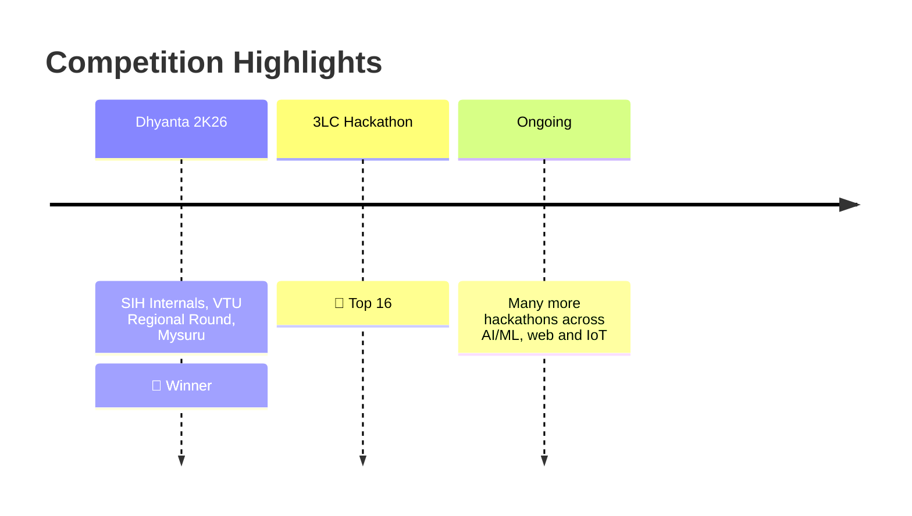

<!-- ===================== HEADER ===================== -->
<div align="center">


<a href="https://git.io/typing-svg">
  
</a>

<br/>


</div>

---

## `> whoami`

```js
const melwin = {
  name: "Melwin Fernandes",
  role: "B.Tech CSE Student (2nd Year)",
  focus: ["Web Development", "AI / ML", "Data Processing"],
  currentlyLearning: "Full-stack web development",
  currentlyBuilding: "AI-powered projects for real-world problems",
  hackathons: "Winner 🥇 | Top 16 🏅 | Always competing",
  funFact: "I'd rather ship a prototype than polish a plan.",
};
```

---

## ⚡ Tech Arsenal

<div align="center">

| Domain | Tools |
|:------:|:------|
| 🌐 **Web** |       |
| 🤖 **AI / ML** |      |
| ⚛️ **Quantum & Optimization** |   |
| 🔌 **IoT & Systems** |    |
| 🧰 **DevOps** |    |

</div>

---

## 🚀 Featured Projects

<table>
  <tr>
    <td width="50%" valign="top">
      <h3>🛣️ <a href="https://github.com/Melwin-2007/MARGA">MARGA</a></h3>
      <p><b>Fraud detection for public infrastructure.</b><br/>
      AI platform that catches fraud, inflated costs, and ghost works in MPLADS projects, from proposal to oversight, using geo-tagged evidence, anomaly detection, and optimised inspection routes.</p>
      <p>
        
        
        
        
      </p>
    </td>
    <td width="50%" valign="top">
      <h3>🎙️ <a href="https://github.com/Melwin-2007/speechCoach">SpeechCoach</a></h3>
      <p><b>Your AI public-speaking coach.</b><br/>
      Analyses pace, pauses, pitch, loudness, and clarity. Compares speech to reference patterns, pinpoints problem regions, explains why they matter, and gives a score with actionable feedback.</p>
      <p>
        
        
        
        
      </p>
    </td>
  </tr>
  <tr>
    <td width="50%" valign="top">
      <h3>⚛️ <a href="https://github.com/Melwin-2007/QUANTA">QUANTA</a></h3>
      <p><b>Quantum-classical exam timetabling.</b><br/>
      Combines Google OR-Tools CP-SAT constraint programming with Qiskit QAOA subproblem refinement, protected by a deterministic classical repair fallback gate.</p>
      <p>
        
        
        
        
      </p>
    </td>
    <td width="50%" valign="top">
      <h3>🌫️ <a href="https://github.com/Melwin-2007/Health-Monitoring">Smart Health Monitoring</a></h3>
      <p><b>IoT air quality guardian.</b><br/>
      ESP32-based monitoring and alert system using CO, gas, temperature/humidity, and dust particle sensors to track the air you breathe.</p>
      <p>
        
        
        
        
      </p>
    </td>
  </tr>
</table>

---

## 🏆 Hackathon Journey



---

## 📊 GitHub Analytics

<div align="center">


</div>

---

## 🎯 Currently

- 🔭 Building AI-powered projects with real-world impact
- 🌱 Deepening my full-stack skills with React and Node.js
- ⚡ Preparing for the next hackathon
- 🤝 Looking for teammates and collaborations

---

## 📫 Let's Connect

<div align="center">

[](https://www.linkedin.com/in/melwin-fernandes2007/)
[](mailto:Melwinfernandes2007@gmail.com)

<br/>

*"Build things. Break things. Win things."*


</div>
